# diffbell architecture

Living document. Any architectural change updates this file and adds or updates
an ADR in `docs/adr/` in the same branch. Design rationale lives in the ADRs and
the original design spec, `2026-10-08-dev-watchman-design.md` (local notes, not published) <!-- old-name -->; the security scope is
[ADR 0007](adr/0007-threat-model-accidental-disclosure.md).

## Components

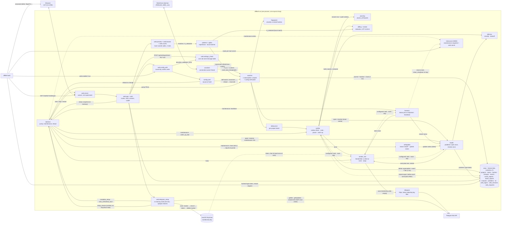

| Module | Responsibility |
|---|---|
| `wmclient` | The only code that talks to Watchman. One connection-owner thread runs every command (submitted through `WatchmanClient.call()`, awaited as a future), reads PDUs and forwards them, plus `connected` / `disconnected` / `error` markers, to the loop. Drains pywatchman's PDU buffers with `pdu["root"]` verbatim. Reconnects with backoff 1 s → 60 s. |
| `watcher` | `watch-project` → `subscribe` per project (`relative_root`, `defer_vcs`, names `diffbell:<project>#<generation>`); chooses since-clock / catch-up / re-baseline; journals changes; self-watches the config file (`watch` on its directory, never `watch-project`, so an ancestor `.git` such as `~/.config/.git` cannot widen the root to `$HOME`; the expression matches the configured file name); re-subscribes after a unilateral error; every 60 s while connected retries projects in `error` whose directory exists and a canceled/failed config subscription (`tick()`); records problems in the health registry, never sends: Watchman down (5-minute grace), a lost watch (a canceled or failed subscription, or a watched folder gone at two ticks in a row, which `tick()` notices off the loop because Watchman does not cancel a watch below its root), a recrawl warning (cleared by the next subscription or after 24 h), the config watch. |
| `fingerprint` | Deletion-first fingerprint precedence; classification of a PDU against stored hashes. |
| `patterns` | Glob list → Watchman expression (`match` with `basename`/`wholename`, `includedotfiles`), always-excluded dirs as `**/<dir>/**`, expression hash, local `matches()` / `is_redacted()` (case- and NFC/NFD-insensitive, fail closed). |
| `globs` | `glob_to_regex` / `compile_glob` define the glob semantics (`IGNORECASE` and `DOTALL`) and validate patterns for `config`; `glob_matches` implements the same semantics in linear time (an NFA over the pattern's tokens, no backtracking), so a pathological pattern such as `"*a" * 12 + "b"` can't freeze redaction, the preview or the tree. The regex stays the test oracle (an equivalence fuzz). Dependency-free so `config` can compile a pattern exactly as the matcher will. |
| `config` | Strict pydantic model, additive built-in lists, pattern validation (`check_pattern`), project resolution (realpath, duplicates), default config text. Errors name projects and entry numbers, never paths ("duplicate project path: entries 1 and 2 (projects a and b)", "project (unnamed): …"), since the web API returns them as 422 bodies. |
| `store` | SQLite: the two durability transactions, outbox status (`pending`, `sent`, `failed`, `held`, `skipped`), pruning; `event_reports` (schema v3), the redacted report of each event's latest delivery attempt; `snoozes` and `batch_reports` (schema v4, which rebuilt `events`; see *Crash and restart behavior*); `problems` and `kv` (schema v5, the health registry and the heartbeat's last slot); `projects` (schema v6, which rebuilt every per-project table on a stable folder id; see *Project identity*); `events.last_error_kind` and `events.last_error_at` (schema v7, added columns: the `ErrorKind` and time written with every failure's `last_error`, cleared with it), from which `telegram_failure()` derives the Telegram card's failing state (see *Telegram setup*); the old `alerts` table is dropped on every open. `query_events(q=…, redact=…)` also searches stored diff lines (see *Search inside diffs*); three `event_reports` triggers bump `kv.reports_epoch`, the key of that search's memo ([ADR 0013](adr/0013-diff-search-and-readability.md)), with no schema version change. |
| `debouncer` | Quiet window / max wait per project; refilled from the journal at startup. |
| `notifier` | Collapse → event → reports → `notify_on` rules (nothing left: `skipped`) → pause (`held`) → render with the deep link → store the report (best effort) → send; retry/backoff; exactly one plain-text fallback. `catch_up_due` sends one catch-up message per project when its held events are due ([ADR 0011](adr/0011-pause-and-rules-in-the-notifier.md)). |
| `pausing` | `pause_until(snooze, quiet, now, configured=…)`: not configured (Telegram not set up) → held forever with reason `setup`, before anything else; otherwise the later end of an active snooze (`HELD_FOREVER` when indefinite) and the local quiet window, and the reason. The quiet end steps real minutes and checks the local wall clock (DST-safe: 23 h and 25 h days, a skipped end time, a fall-back out of the window). Pure. |
| `diffing` | The fallback's per-file reports: `git diff HEAD` hunks, first lines of an untracked new file, or metadata only, with `first_line` (the first changed line, `first_changed_line`: the hunk header's new-side start plus the context lines above the first `+`/`-` line, a deletion where it sat, at least 1; 1 for an untracked new file; None without a hunk); the one hunk parser (`parse_diff`, splitting on "\n" only: `split_lines`); the hardened reader (`read_capturable`); the git note (`git_notes`, `ObjectFormats`). Never reads a redacted file. |
| `snapshots` | Content snapshots ([ADR 0017](adr/0017-content-snapshots.md)): `Snapshotter` captures an event's "after", note and branch (`capture`) and a baseline's contents (`read_baseline`), and builds content-based reports with the isolated `git diff --no-index` engine (`report`; `check_isolation`, `sweep`). See *Content snapshots*. |
| `render` | Layout A2 (see *The Telegram message*), HTML or plain text within 4096 UTF-16 units: halve the per-file lines, drop the quote, collapse trailing files, clip the header. `compose()` returns `Composed(text, lines, files)`: the per-file budget whose lines reached Telegram (0 once the quote is dropped) and the files listed, in message order (`message_order`: modified, created, deleted, redacted), which is also the order the notifier stores. `MessageContext` carries the deep link (`event_id`, `more`, `web_port`: a last line "🔗 Open #ID", only with both an event and a running web server; the sample never has one) and an optional `CatchUp` header. Control, line-separator and bidi characters are shown, never obeyed (ADR 0017, "Display of control characters"): in names and notes as `\uXXXX`, in diff lines as one visible character each (`visible`: Control Pictures, "␡", "⍰"); a report whose every line ends in "\r" shows them without it (`display_lines`). |
| `telegram` | Bot API client with the retryable / auth / bad-request error taxonomy (plus `NOT_SET_UP`, raised only by the sender slot as `NotSetUp`); `send(…, silent=True)` sets `disable_notification`. |
| `sender_slot` | `SenderSlot`, the `Sender` the daemon, notifier, health and heartbeat hold: a `TelegramClient` or nothing. `configured`; `bot_username` (a background `getMe` after start, never on the start path; at a swap, the draft's); `send` raises `NotSetUp` while empty; `swap(token, chat_id, *, bot_username)` installs the new client on the loop thread with no `await` before `configured` is true; in-flight sends are counted per client, and the old client is closed after its last one ([ADR 0018](adr/0018-unconfigured-start-and-web-bot-setup.md)). |
| `delivery` | The classification of a failed send and its delay (a 429's `retry_after`, else 30 s → 30 min), shared by the notifier and health; each applies its own policy. |
| `secrets` | Keychain get/set/delete through `/usr/bin/security` under `service()` (`io.688.diffbell`, or the scratch-only `DIFFBELL_KEYCHAIN_SERVICE`: only `io.688.diffbell` or `io.688.diffbell-<suffix>`); `credentials()` (the pair, or why it is not set up: both absent, one absent, the `save-pending` marker; a read error raises) and `save_credentials` (both values checked, then marker → chat id → token → delete marker), shared by `setup` and the web wizard. |
| `health` | The registry of operational problems (`open`, `resolve`, `forget`, one-shot `notice`); `tick` sends a serious problem once past its grace and its resolution once, as plain text, retried on the shared backoff per row ([ADR 0012](adr/0012-health-registry-and-liveness.md)); `tick(now, sending=False)` while Telegram is not set up deletes notices and resolved rows unsent, and `rearm` at a save gets each open, unannounced serious problem announced once (a running grace is kept; one with failed attempts starts over). |
| `liveness` | `status.json`: the atomic 0600 write, `write_failure_status` (no watcher needed), `restart_message`; `wait_until_ready` (`install`, `upgrade`); the silent daily `Heartbeat`. |
| `selfupdate` | `Install.current` at start (installed version; Homebrew's resolved `opt/diffbell`); `SelfUpdate.check` from maintenance, at most every 60 s, against that start snapshot: a newer install under launchd stops the daemon normally and `KeepAlive` starts the new one (outside launchd it only warns); `queue_update_notice` at start, the silent "updated: Y → X" notice ([ADR 0022](adr/0022-self-restart-after-an-upgrade.md)). |
| `lock` | Singleton `flock` on `daemon.lock`; `holder_pid()` for `status`. |
| `paths` | Config, state and log locations, with `DIFFBELL_*` environment overrides; `own_paths` (diffbell's own dirs and files), `tighten_install` (narrows them) and `loose_modes` (reports them, read-only, for `doctor`). |
| `models` | `Change`, `ChangeKind`, net-effect `collapse()`. |
| `daemon` | Wiring; background tasks and their supervision; maintenance; `status.json` (0600); the web server's lifecycle and per-start secret. |
| `web.server` | `WebServer`: a fresh `uvicorn.Server` per start on the daemon loop, on a socket it binds to 127.0.0.1 itself (port in use → `WebStartError`). No access log, no uvicorn signal handlers, `SystemExit` contained, bounded stop; uvicorn's listeners are closed after a crash. |
| `web.app` | `create_app(WebContext)`: the routes, a middleware doing the Host check, the 1 MiB body cap, session, Origin and CSRF checks before routing, the security headers, and the `{"error": …}` envelope. `/healthz?challenge=` answers with an HMAC proof. Every handler is `async def` (the SQLite connection belongs to the loop thread). |
| `web.auth` | Login tokens (60 s, single use, bound to the server's secret), 30-day sessions and CSRF tokens; only SHA-256 hashes are stored. Host/Origin checks, security headers, `/healthz` proofs. Framework-free so the CLI can import it. |
| `web.config_edit` | Every config edit: ruamel round-trip, typed mutation, validation with the daemon's models and `resolve_projects`, atomic replace of the resolved target (a symlinked config stays a symlink); `config_version` = SHA-256 of the file bytes (409 on mismatch, file untouched on 422). |
| `web.settings_check` | The one table of settings rules and messages ([ADR 0019](adr/0019-settings-save-bar-validation-telegram-failures.md)): `check_settings(raw)` → `CheckResult(errors, issues)` for `POST /api/settings/check` (writes nothing) and `PUT /api/settings` (422 `{error, errors, issues}`, checked before `config_version`); `message_for` gives `config_edit.describe_validation_error` the same sentences (the web only: the daemon's config-load error keeps its text). Numbers arrive as typed text: empty or non-numeric is an error, never 0. Pure: reads and writes no file. |
| `web.preview` | The live preview: `os.scandir` walk in a worker thread (2 at a time, `Previewer.in_slot`), Watchman-equivalent matching, caps 500 files / 100 000 entries / 3 s (`total_exact` is false when a cap stopped the walk); error messages never echo the path. Never touches Watchman. The walk is targeted (`plan_starts`): with no pattern lacking "/", it lists only a literal path's parent folder and walks below an anchored glob's literal prefix; one pattern without "/" or without a literal first folder (`*/x.json`) walks the whole tree. |
| `web.browse` | One folder of the editor's tree (`POST /api/browse`): names, `matched_by` / `ignored_by` from the preview's matcher; opened component by component with `O_NOFOLLOW` relative to the parent's descriptor (no symlink, no check-then-use gap), always-excluded folders refused with the preview's case- and NFC/NFD-insensitive probe; 2,000 entries / 1 s, in a preview slot. |
| `web.telegram_setup` | The Settings → Telegram wizard's endpoints (`/api/telegram`, `/api/telegram/draft…`): one in-memory `Draft` (token, bot, creation and last-used time, chat choices, the `getUpdates` offset; 30 min sliding TTL, an expired one also swept on create and on `GET /api/telegram`; replaced by a new one, kept on a failed save), chats offered as random `choice` handles and only if their message is dated at or after the draft (they accumulate across polls; each poll confirms what it read through the draft's offset), the sample message as the test, the save (a second one on the same draft while one runs is 409) through `save_credentials` in `asyncio.to_thread`, then `complete_setup` (a Keychain error while saving, `SecretStoreError` or `OSError`, calls `note_unfinished_save`). `GET /api/telegram` adds `reason` (the daemon's cached `setup_reason()`) and `failing` (`Store.telegram_failure()`). Never returns the token, the chat id or a URL. |
| `web.counts` | The dashboard's `watched_count`: a preview walk per project, started only by a `GET /api/dashboard` (never a timer), cached 60 s per (project, the effective lists walked); a failed count is not retried for 60 s; removed projects are forgotten, and so is a project whose watch is lost (`forget`, also a count in flight, while its `project:<name>` problem is open: the card shows "—"). Counts run one at a time through `Previewer.count_gate` and `in_gated_slot`, which holds the gate until the walk's thread ends (even if the request is cancelled), so one of the two slots always stays free for the editor. |
| `cli`, `setup_cmd`, `launchd` | Commands, interactive setup, LaunchAgent install/uninstall; `launchd.agent_status` reads (loaded, pid) from `launchctl print`. `install` writes the default config when none exists and, while Telegram is not set up, turns the web UI on (only when `web.enabled` is absent: `config_edit.web_enabled_set`) and opens Settings → Telegram through `_open_page`, shared with `web`. The plist's `EnvironmentVariables` hold only `PATH`. Its program is `launchd.find_executable`: the `diffbell` on PATH, resolved, with a Homebrew Cellar path mapped to its stable `opt` path (`stable_executable`, ADR 0021). |
| `doctor` | `diffbell doctor`: thirteen read-only checks (`Check(name, status, message, fix)`) with injected runners, 5 s each, side by side. Never opens the `Store` (SQLite `mode=ro`), never starts Watchman (`watchman --no-spawn --no-local` `version` and `watch-list`, no `WatchmanClient`), never prints a secret. |
| `upgrade`, `install_source` | `diffbell upgrade`: read-only git, a 0600 SQLite backup (3 kept), `uv tool install --force --reinstall`, the new tool's `install` and `doctor --json --pending-source '<JSON>'` (the source being installed, judged by the Install check; a doctor from before Plan 7 rejects the option with exit 2 and "unrecognized arguments" and is run once more without it); `install-source.json` (0600) records the source on success. Every line it prints is flushed before the next subprocess. No automatic rollback. |

`pywatchman` is imported only by `wmclient` and `watcher` (the latter for its
exception types). Besides the connection thread, the only other threads are
short-lived `asyncio.to_thread` workers for git (report building), for web
previews, tree listings and counts (at most 2 at a time) and for joining the connection thread at shutdown.
The web package never imports `pywatchman`, `wmclient` or `watcher`
(`tests/web/test_boundaries.py`, an AST check) and never receives the
`WatchmanClient` (`WebContext` has no field for it).

## Watchman connection (`wmclient`)

- `_Client` subclasses `pywatchman.client` so that a **unilateral error PDU**
  is stored in `unilateral_errors` instead of raising `CommandError` from inside
  `query()` (which would fail an unrelated command and leave its real response
  for the next one). The owner thread forwards each stored error as a
  `{"_diffbell": "error", "pdu": …}` marker; the watcher re-subscribes the named
  project.
- Socket timeouts: commands run under `command_timeout` (30 s); between
  commands the socket waits only `recv_timeout` (0.2 s) in `receive()`, so
  queued commands are picked up quickly.
- pywatchman declares `subs`, `sub_by_root` and `logs` as class attributes
  shared by every instance; each new connection gets its own private buffers.
- After every command and every `receive()`, all buffered PDUs are drained with
  `getSubscription(name, root=pdu["root"], remove=True)` and forwarded.
- `_emit` (the hand-off to the loop) is guarded: a failing callback is logged and
  never kills the connection thread.
- A lock makes "connected and not stopping → enqueue" atomic with
  "disconnect → fail every pending command", so no `call()` can hang forever.

## Event pipeline

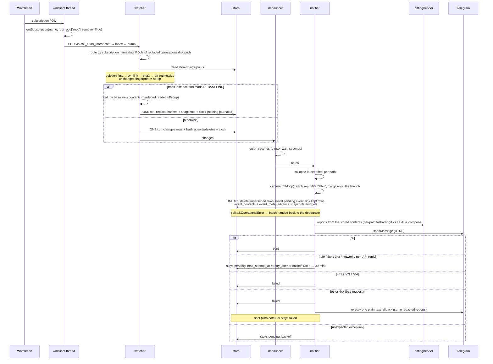

Retries come from the maintenance loop (`retry_due`, every 5 s). `deliver`
re-reads the event and skips it unless it is still `pending` and due, so a
deferral recorded after `retry_due` took its snapshot is honoured; an in-flight
set prevents two concurrent sends of the same event.

## Notification controls (snooze, quiet hours, notify_on)

Decided only in the notifier ([ADR 0011](adr/0011-pause-and-rules-in-the-notifier.md));
events are always created. Snoozes live in `state.db` (`snoozes`), quiet hours
(`notify.quiet_hours`) and `notify_on` in `config.yaml`.

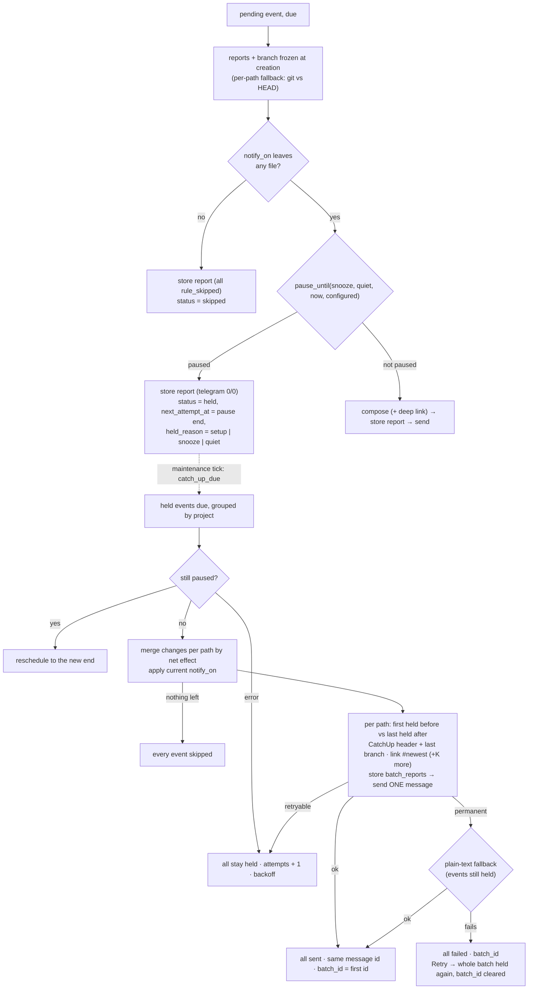

- **Rescheduling:** `DELETE /api/projects/{name}/snooze` and a new snooze make
  that project's snooze-held events due now; a reload that changes the quiet hours
  makes every held event due, whatever its reason (one held as "snooze" may be
  waiting on the quiet hours' later end); a reload that removes a project deletes
  its snooze and makes its snooze-held events due (a renamed project keeps its id,
  and its snooze). The next
  catch-up check holds them again if a pause still applies.
- **Not set up** ([ADR 0018](adr/0018-unconfigured-start-and-web-bot-setup.md)):
  while the sender slot is empty every event is held forever with reason `setup`,
  before the snooze and the quiet hours are looked at. The wizard's save releases
  them (`release_held(reason="setup")`); the next catch-up check re-holds a group a
  snooze or the quiet hours still cover. A catch-up's reason is `setup` if any event
  was held for setup, else `snooze`, else `quiet` ("held until Telegram was set up").
  A `NotSetUp` from a send holds the event or batch with reason `setup`, never
  `failed`.
- **Net effect:** a path's merged kind is created→modified = created,
  deleted→created = modified, created→deleted is dropped (as `models.collapse`
  drops it within one event); a group left empty is `skipped`.
- **A removed project's** catch-up still goes out, marked "(removed)", with every
  kind and file names only (no path to diff in). A configured project whose folder
  is missing keeps its `notify_on` and is not "(removed)".
- **Guarded transitions:** only `pending` events become `held` (retry state reset)
  or `skipped` (`mark_skipped` also takes `held` ones and clears the error); the
  batch transitions (sent, retry, failed) act only on `held` events.
- **At-least-once:** if storing the outcome fails after a send, the group stays
  held and is sent again.
- **Health:** a held event with `attempts > 0` and an error is reported by
  `telegram_health` first, whatever was sent since, so a stuck catch-up shows
  "Telegram failing".
- **Deep link:** `NotifierSettings` is read per delivery; the link and the "see
  web UI" hint follow the running web server (`running`, bound `port`), not just
  the config.

## The Telegram message (layout A2)

```
<b>🔑 myapp</b> · <code>main</code> · 11:42            header: project, branch, time
4 files · +2 −1                                        summary (non-redacted totals)
✏️ <code>package.json</code> +1 −1                      modified, created, deleted,
➕ <code>migrations/x.sql</code> +1 −0                  then redacted; report order
🗑 <code>Dockerfile.old</code>                           within each kind
🔒 <code>.env.local</code> · contents hidden
<blockquote expandable>package.json                    one folded quote: per file
<code>   -  &quot;a&quot;: 1                         its path, then its lines
   +  &quot;a&quot;: 2</code>                         (escaped, 3-space indent),
migrations/x.sql                                       in ONE <code> per file
<code>   +CREATE INDEX i;</code></blockquote>
🔗 <a href="http://127.0.0.1:8765/?event=42">Open #42</a>
```

- The lock screen shows the header and the summary, not a diff. Per-file counts come
  from the report's lines; none for deleted or redacted files or files without
  lines (those show their note instead: "binary file changed", "matches HEAD"). A
  file at diffing's 200-line cap may have more: its counts (and the totals) read
  "+150+ −50+".
- Each file's diff lines (and its "… (N more lines)" marker) share ONE multi-line
  `<code>` in the quote (monospace; the path lines stay plain). Checked with real
  sends (Plans 5a and 5b): `<code>` inside the expandable quote is accepted and
  renders monospace on the Mac and Android, while `<pre>` splits the quote on
  Android, so `<pre>` is never used (a test pins it). One `<code>` per line was
  dropped: Telegram apps ignore formatting entities past about 100 per message
  (probe B in ADR 0013 showed its last files plain; one block per file, probe C, rendered
  every file). As a safety net, a rendering with more than `ENTITY_LIMIT` (90)
  entities (`entity_count`: each `<b>`, `<code>`, `<blockquote>`, `<a>`) quotes its
  lines without `<code>`, so the formatting degrades uniformly. The tags count
  toward the 4096 budget. The plain-text fallback has the same lines and
  order, with each file's diff inline under it, and no tags.
- Bidi control characters (U+200E/F, U+202A–U+202E, U+2066–U+2069) in the project,
  branch, a path or a note are shown as their `\uXXXX` form, in HTML and plain text,
  so a name can't reorder what the reader sees.
- A catch-up reads `<b>🔕 Catch-up · proj</b> (removed) · <code>branch</code> ·
  held 14:05–15:40 (snoozed)` (the branch frozen with its last event; a `setup`
  hold reads `held until Telegram was set up (14:05–15:40)`), then
  `3 changes in 2 files · +a −r`, and links `Open #ID (+K more)`.
- Shrinking to 4096 UTF-16 units, in order: halve the per-file line budget down to 0
  (at 0 each file's quote entry says "… (N lines hidden)"), drop the quote
  (`Composed.lines` = 0), collapse the trailing files ("…and K more files"), clip
  the header fields, hard-truncate. Header, summary and link survive every step but
  the last two. Readable golden texts in `tests/test_render.py` pin the layout.

## Health registry and liveness

[ADR 0012](adr/0012-health-registry-and-liveness.md). Sources open and resolve
problems; `Health.tick` (maintenance, every 5 s) is the only sender of alerts.
`delivery.py` holds the classification of a failed send and its delay, shared with
the notifier; the alert policy retries every kind (AUTH and BAD_REQUEST included).

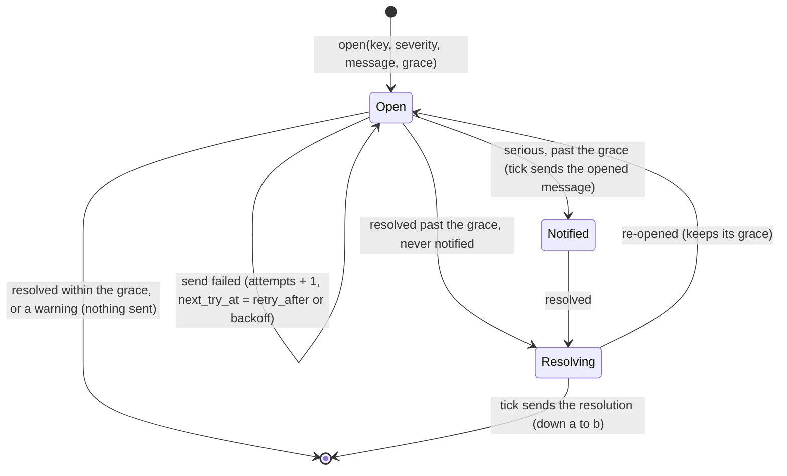

- `tick` re-reads every row before sending it. After a retryable failure (Telegram
  down) the remaining due rows are deferred without a call, each on its own backoff
  step (or the 429's `retry_after`; one that is not a finite, non-negative number is
  ignored, so `next_try_at` is never NaN).
- A message sent whose store write then fails (e.g. "database is locked") is kept
  in memory and only its write is retried on the next ticks, never the send (logged
  once, type name only); the heartbeat does the same for its slot.
- `resolve` makes the resolution due at once, or after the backoff of a failed
  send: a re-open's grace (Watcher.__init__ opens `watchman` with 300 s at every
  start) delays only the re-open's ⚠️, never the ✅, and never turns an outage
  already past its grace into a silent one. Once that ⚠️ has been tried, its
  backoff (or `retry_after`) sets the ✅'s due time.
- An outcome is recorded only if the row still has the `opened_at` it was sent
  with. Every fresh row gets an `opened_at` unique per key, so a forgotten or
  replaced row never takes another's delivery state; a message that changes while
  its ⚠️ is in flight is still one problem, one ⚠️. Texts are compared only for
  notices.
- A severity change on a key is a fresh problem (forget + open), unless the row is
  serious with its ⚠️ sent: it stays serious, so its ✅ goes out.
- `open` with a grace logs at INFO; `tick` logs the WARNING once the grace is over.
- `last_error` has the bot token redacted; messages are clipped to 1000 characters.
- **Not set up** ([ADR 0018](adr/0018-unconfigured-start-and-web-bot-setup.md)): the
  daemon calls `tick(now, sending=slot.configured)`. Muted, each tick deletes every
  notice row and every resolved row unsent, whatever its due time, and leaves open
  problems as they are (page, `doctor`). A save calls `rearm(now)` (best effort): each
  open serious problem whose ⚠️ never went out is announced once on a coming tick; one
  with failed attempts starts over (`next_try_at = now`, `attempts` 0), one with none
  keeps its `next_try_at` (a running grace still runs); one already announced is not
  re-sent; one that opened and resolved while muted sends nothing. The heartbeat is
  skipped without writing its slot; on a first setup (not a bot replacement) a save
  past today's time records today's slot (`mark_done_if_past`).

Messages: opened "⚠️ Diffbell: {message}"; resolved "✅ Diffbell:
{resolved words} (down HH:MM–HH:MM)", or "(was down HH:MM–HH:MM: {message})" when
the opened message never got through.

| Key | Severity | Opened by | Resolved by |
|---|---|---|---|
| `watchman` | serious, grace 300 s (fix: `watchman version`; `brew install watchman` when no `watchman` binary is on the daemon's PATH) | the watcher, not (yet) connected | connected |
| `project:<name>` | serious | a canceled/failed watch, a failed subscribe, the folder gone at two ticks in a row, a reload finding a watched folder missing | a successful subscribe |
| `recrawl:<name>` | warning (fix: `watchman watch-del <q> ; watchman watch-project <q>`, `shlex.quote`d root) | a recrawl warning in a PDU | the next subscription, or 24 h without one |
| `missing:<name>` | warning (the advice is in the message) | a configured folder missing at a (re)load | the folder is back (every present project is resolved at each check, also at start) |
| `config-watch` | serious | the config directory can't be watched | it is subscribed again |
| `config` | serious | a rejected config | the next valid one (also at start) |
| `web` | serious | the web UI fails to start or crashes | it starts (turned off: forgotten) |
| `telegram` | warning | `telegram_health` reports an error | the next successful send, or not set up (nothing to fail) |
| `telegram.setup` | warning (fix: `diffbell setup`) | a start without credentials, with one item, or with the `save-pending` marker (the message names which) | a successful save in the wizard, or a start with credentials |
| `restart` | one-shot notice | a start after an unexpected stop | sent once |

`fix` only ever holds a runnable command; the page shows it on a project's badge
with a **Copy** button (toast "Fix copied"), never runs it. Global problems are
named next to "needs attention"; their fix (e.g. `watchman`'s `watchman version`)
is in `/api/dashboard` only. A removed project's
problems are forgotten without a message (`forget` is only for removed or disabled
sources; everything else is resolved). Rows persist in `problems` with their
delivery state, so a restart keeps them and never sends "opened" twice;
`/api/dashboard` lists the current ones (not notices, not resolved; only global
ones and those of configured or missing projects) with `notified`, `attempts` and
`last_error`, and the page says "alert not delivered yet" while a serious one is
stuck. A serious global problem (`config`, `config-watch`, `web`) is named in the
status sentence, also next to "N projects need attention".

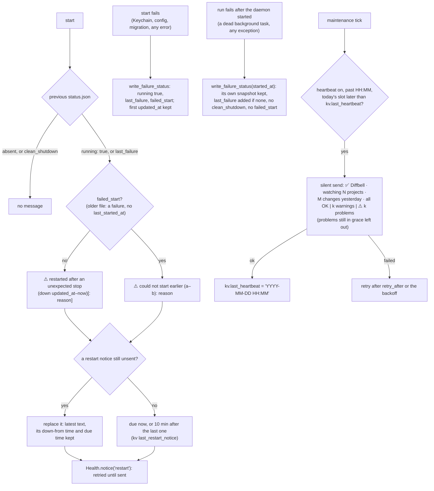

- The heartbeat is checked every tick: a Mac asleep at the time sends after waking,
  a missed day is not caught up, the first run waits for the next slot, a time moved
  later than the one today's went out at sends one more that day, at that time or at
  once if it has passed (moved to that time or earlier: nothing more today,
  `last >= slot`), turning it off
  deletes the kv row (so turning it on waits for the next slot), and quiet hours and
  snooze don't apply. Off is written to the config as `heartbeat: null`, on as a
  double-quoted time. "Yesterday" is the previous local calendar day (23 or 25 hours
  on a DST day).

## Project identity (schema v6)

A project is its **folder** ([ADR 0016](adr/0016-stable-project-ids.md)). `projects`
gives each canonical path (`realpath(expanduser(path))`, no trailing slash) a stable
id, and every per-project row keys on it. The name is a label: the config name while
configured, the last one it had afterwards.

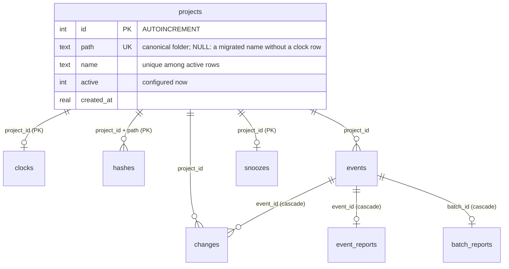

- **Sync:** `Store.sync_projects([(name, path), …], now)` runs in one transaction:
  every row inactive, then each configured folder's row takes its name and is active
  again (a new folder gets a new id), then the Store rebuilds its in-memory
  name → id map from the active rows. The daemon calls it first in `_apply_config`,
  at start (after the migration, before the watcher subscribes) and on every reload
  (before the reconcile), with every configured project, missing folders included.
  `status` and `web` sync with the config they load (skipped for an invalid one,
  and when the database stays locked past the busy timeout). They never open the
  Store on a database from before v6 (`events` without `project_id` or
  `user_version` < 6, read `mode=ro`) while a daemon holds the lock: opening
  migrates, and the running daemon may be the old code. `status` then prints no
  counts and "the database needs migrating: restart the daemon (`diffbell
  install`)"; `web` refuses with that advice (exit 2).
- **Names stay at the edges:** the watcher, notifier, health, Telegram texts and the
  web API speak configured names; the Store translates. A write for a name that is
  not configured raises `UnknownProject`; a read by name returns nothing. Queries that
  return a name join `projects`, so a past event shows under the current name.
  `create_event` takes its journal rows' project, so a batch the debouncer queued
  under a name a reload renamed or removed is still recorded. `problems` keeps names.
- **Rename** keeps the id: history, baseline, clock and snooze stay, nothing
  re-baselines. **Removing** a project deactivates its row; re-adding the folder
  reactivates it. **Moving** a folder is a new id with a fresh baseline. A path that
  differs in case from the on-disk folder is a different project.
- **Subscription tokens:** each watcher subscription records its project id
  (`Store.project_token`) before the `watch-project` await and re-checks it after,
  plus that the project is still the latest reconcile's `_desired`. The reconcile
  also re-subscribes a name whose token no longer matches the Store's (a symlinked
  project path retargeted: the ResolvedProject is equal, the folder id is new), and
  a subscribe a sync left pending. Writes pass
  `expect=token`; a stale token raises `UnknownProject` and the PDU is dropped. That
  is safe: the clock is per id and the reconcile re-subscribes from it, so Watchman
  replays. The first drop per name per reconcile logs a WARNING; an `UnknownProject`
  during subscribe leaves the state pending, never a Health problem. The reconcile
  must run right after every sync, with no `await` between.
- **One event, one folder:** the notifier splits each debouncer batch by project id
  (`Store.split_by_project`) before collapsing; `create_event` refuses mixed rows.
  Events carry `project_active`: an inactive project's event takes the "project no
  longer configured" path (no folder read, no snooze, all kinds), catch-ups included
  (grouped by name and active), and the web page offers no folder actions (Open, git
  log) for it.
- `status` and `web` sync the rows from the config they load, so names and `active`
  may change before the daemon reloads; writes stay correct, ids being per folder.

## Subscribe decision (clock reuse, re-baseline, catch-up)

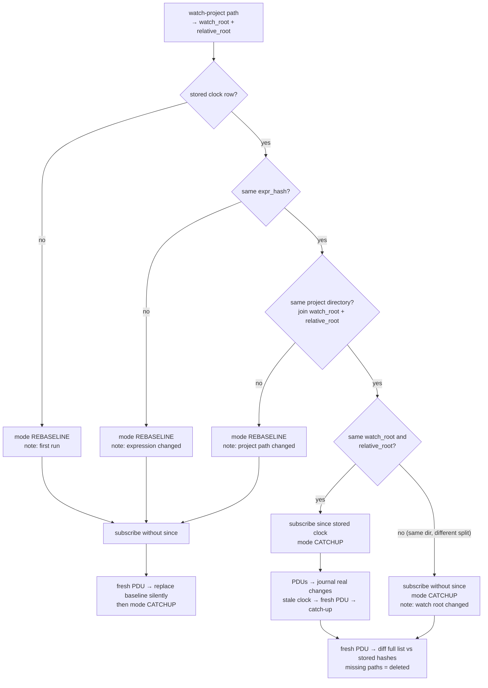

Only an explicit REBASELINE records silently. A fresh instance in CATCHUP mode
is always diffed against the stored hashes, including an empty stored baseline
("no matching files" is a real baseline), so changes made while the daemon or
Watchman was down are reported, never swallowed.

Each `subscribe` call uses a new generation suffix (`diffbell:<project>#<n>`) and
the watcher routes PDUs by the full name, so a late PDU from a replaced
subscription can never reach the new state.

## Config reload

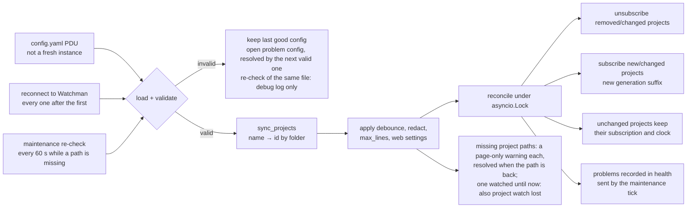

The config self-watch ignores its own fresh instance, so an edit made while
Watchman was unreachable would be missed; therefore every reconnect after the
first reloads the config (outside the lock: reconcile takes it, and
`asyncio.Lock` is not re-entrant). Subscription changes from `reconcile`, from
`connected` markers and from error re-subscribes are serialized by the lock;
problems found while it is held are only recorded (health never sends from `open`),
so a slow Telegram call never stalls subscription changes. Reloads themselves are
serialized by a second lock in the daemon, so a self-watch reload and a
missing-path re-check never interleave. A project whose directory is missing is
left out of the desired set (it is not a validation error, so it never rejects
the rest of the config); it is a page-only warning (`missing:<name>`, its advice in
the message). If it was being watched, the reload also opens `project:<name>` ("watch
lost"): the reconcile unsubscribes it before the watcher's tick could notice. Once the
directory exists again the next reload adds it like any new project and resolves
the warning (and the subscribe resolves the lost watch). A missing-path re-check that re-reads an invalid config with the same
mtime and size as the last rejection logs at DEBUG and reports nothing new. A
project removed from the config takes its problems with it, without a message.

A project already being watched can still fail: its directory is deleted (Watchman
sends a `canceled` PDU when the folder is a watch root; below a root it does not,
and `Watcher.tick()` notices the folder is gone) or another tool removes the watch.
It is marked `error` and the serious problem `project:<name>` ("watch lost") is
opened; reconcile would never touch it again (the project is unchanged), so
`Watcher.tick()` retries every project in `error` whose directory exists every
60 s while connected (unsubscribe, then subscribe under a new generation), and the
successful subscription resolves the problem ("watching again"). A canceled or
failed config subscription is re-subscribed in the same pass (followed by a reload,
since edits made meanwhile were missed); a failing config `watch` opens
`config-watch`, resolved once it is subscribed again.

A symlinked config (a dotfiles setup) is watched twice: at the link, so a
retargeted link is noticed, and at its resolved target (`diffbell-config-target`), the
file a web save actually rewrites, which may live in another directory. A
retargeted or no longer symlinked config moves or drops the target subscription.

## Content snapshots

[ADR 0017](adr/0017-content-snapshots.md); spec
`2026-10-15-content-snapshots-design.md` (in the maintainer's local design notes, not published). A diff shows what
changed in this burst: the file as of the previous event (or the baseline) against
the file at this event's creation.

| Table (additive, no `user_version` bump) | Holds |
|---|---|
| `snapshots (project_id, path, content, captured_at)` | each watched file's current "before" |
| `event_contents (event_id, path, before, after, after_state, note)` | what each event's diff is built from; `after_state` is `content`, `deleted` or `uncapturable` |
| `event_meta (event_id, branch)` | the branch frozen at creation |

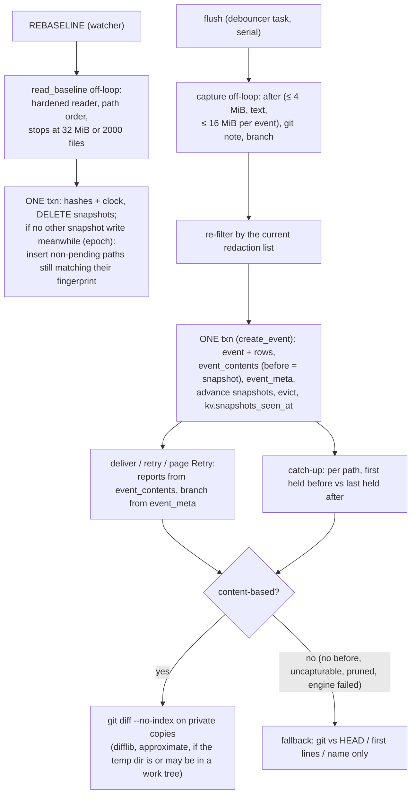

- **Capture.** `Notifier._flush_one` reads each kept change's "after" with the
  hardened reader (`diffing.read_capturable`) in a worker thread, plus the note
  (`git_notes`: one `ls-tree -r -z HEAD`, no `-l`, and one `ls-files -z`, in the
  project folder, literal pathspecs; "committed" = the after's blob id is `HEAD`'s,
  object format cached per toplevel) and the branch; only for a configured
  project's folder, never for a redacted path. `Notifier._still_unredacted` then
  drops any path the redaction list current now covers (a reload may have added a
  pattern during the capture). `create_event` then writes it all
  in one transaction: `before` is read before any eviction, and the event's paths
  are exempt from it; `content` upserts the snapshot, `deleted` and `uncapturable`
  delete it. Every event advances the snapshots, skipped and held ones too. A
  project removed from the config during the capture keeps the event's contents
  but gets no snapshot (its row is deleted). An inconsistent `Captured` raises
  `ValueError` when built, so a capture bug stores no contents (every path falls
  back) instead of failing `create_event`.
- **The chain.** A save between the end of the burst and the read belongs to this
  event's "after" and is the next event's "before". This holds only while flushes
  stay serial (the debouncer awaits each flush; `_flush_one` is the only writer
  that advances snapshots from captured afters).
- **The baseline never regresses a snapshot.** The REBASELINE is the other writer
  (`Store.replace_baseline(..., snapshots_epoch=)`): it stores no content for a
  path with a journal row not yet in an event (that row's flush captures the
  after), and nothing at all if another snapshot write happened during its read
  (`_store_contents`, `sync_projects`, `drop_stale_snapshots` and `forget_redacted`
  bump a per-project in-memory epoch the watcher takes before the read). A path
  left out falls back once.
- **The engine** (`Snapshotter.run_engine`): two files `before`/`after` in a fresh
  `mkdtemp` under `<state>/snapshot-tmp` (0700, files 0600), `env -i` with a
  private `HOME` and `XDG_CONFIG_HOME`, `GIT_CONFIG_NOSYSTEM`,
  `GIT_CONFIG_GLOBAL=/dev/null`, `GIT_ATTR_NOSYSTEM`, `LC_ALL=C`, `PATH` = the
  directory of the git found at start; `-c core.autocrlf=false -c
  core.attributesFile=/dev/null -c diff.algorithm=myers -c diff.indentHeuristic=true
  diff --no-index --no-color --no-ext-diff --no-textconv`. Outcomes: rc 1 + empty
  stderr + a hunk → lines (by `parse_diff`, which splits on "\n" only, so a line
  separator in content can't fake a header or a line); "Binary files" → "binary
  file changed"; rc 0 and no output → "no content change"; anything else → the
  fallback. An exception out of the engine is that path's fallback too (logged by
  type only); the rest of the message still goes out.
- **When content-based:** `content` with a `before` (modified), `content` and
  created, `deleted` with a `before`. Anything else falls back per path. An event
  whose project was removed after its creation renders from its stored contents
  and frozen branch; its folder is not read.
- **Budgets:** 4 MiB per file, 16 MiB per event (path order; each read bounded by
  what is left, a spent budget opens no further file, and a path past it is stored
  `uncapturable` with neither side), 32 MiB of snapshots
  per project (evict other files' least recently captured first, by `(captured_at,
  path)`), 64 MiB of `event_contents` per project (settled events first, then
  waiting ones, oldest first; their `event_reports` stay).
- **Housekeeping:** `sync_projects` deletes a removed project's snapshots after the
  sync; `_apply_config` deletes the snapshots and contents a grown redaction list
  covers (and on the first apply; `forget_redacted` runs only in the daemon
  process, and a failed one stays pending, retried by the next apply and the
  maintenance tick, at most once a minute); `prune` deletes `event_contents` and `event_meta` with
  `event_reports` (30 days); the temp sweep (dirs older than an hour) runs in
  `Daemon._prune` (start and daily), independent of the store prune.
- **Start checks** (`Daemon._start_snapshots`, after the watcher's reconcile and
  before the recovered journal rows are enqueued and `wm.start()`): the downgrade
  guard (a clock advanced more than 10 minutes after `kv.snapshots_seen_at`, which
  every contents-writing transaction and each maintenance tick record, means older
  code ran: all snapshots are dropped), then the work-tree check
  (`rev-parse --is-inside-work-tree` in the temp dir under the minimal
  environment): "isolated" resolves the `snapshots` warning, "work_tree" opens it
  ("the state folder is inside a git repository: diffs are approximate"),
  "unknown" opens it too ("could not verify the state folder is outside a git
  repository: diffs are approximate"); both non-isolated outcomes use approximate
  difflib.

## Redaction and file contents

Redaction is decided per path by the local matcher (`patterns.is_redacted`) and
must cover at least everything Watchman's `match` matches:

- Directory components: a pattern without `/` matches the basename (as
  Watchman's `basename` scope does) **or any directory component**, so
  `*secret*` redacts `config/secrets/db.yaml`. Only redaction widens;
  `matches()`, which mirrors the watch expression, keeps basename semantics.
  A pattern with `/` is anchored and gets no component matching: to redact a
  directory, use `dir/**` (`config/private` alone matches only that path).

- Case-insensitive (`IGNORECASE`): Watchman's `match` is case-insensitive on
  APFS. On a case-sensitive volume this over-redacts (the safe direction).
- Unicode: a pattern matches if it matches with both sides in NFC or both in NFD
  (APFS keeps names in the form they were created with).
- `DOTALL`: `**` spans names containing newlines, as in Watchman.
- Constructs the local matcher cannot honor are rejected at config load
  (`config.check_pattern`): backslash escapes, POSIX classes (`[:alpha:]`), a
  class starting with `]`, an unclosed `[`, `//`, a trailing `/`, and ranges that
  are invalid in either NFC or NFD form (each pattern is compiled in both).
  A pattern that still fails to compile at match time counts as a match.
- Matching (`globs.glob_matches`) is an NFA simulation in O(name × pattern)
  time with the regex's exact semantics, never a backtracking regex, so no
  pattern can stall redaction, the preview, the tree or the counts.

`diffing` never opens or passes a redacted file to git. For every other file:

- an `lstat` check runs before any git call (`_content_problem`): hard-linked files
  (`st_nlink > 1`, the content may be shared with a redacted name) and non-regular
  files (FIFOs, devices, sockets) are refused. Symlinks pass this check and are
  never followed by diffbell;
- **tracked** files (`_git_report`) then go to git with `--literal-pathspecs` (no
  pathspec magic), `diff --no-textconv --no-ext-diff` (no user-configured drivers)
  and `stdin=DEVNULL`. A tracked symlink shows its target change via `git diff`,
  and git itself refuses tracked paths beyond a symbolic link;
- **untracked new** files (`_head_report`) get the fd-level checks: the path's real
  location must be inside the canonical on-disk project root (`F_GETPATH`) and not
  redacted, the file is opened with `O_NOFOLLOW | O_NONBLOCK`, and the opened fd
  is re-verified (type, inode, link count, real path) before reading. An untracked
  symlink is reported as metadata only ("symlink → target").

Content snapshots read files only through `read_capturable`, which applies the
`_head_report` guard to every file (a redacted name is refused before anything is
opened) and decides size and text on the bytes read.

Residuals (accepted, see ADR 0007): in the fallback, git may still run *clean*
filters on the worktree side of a diff of a non-redacted file (content-based
reports run `--no-index` on private copies with every attribute source closed, so
they can't); an iCloud "dataless" placeholder can make a read block until the file
is downloaded (bounded for git by its 10 s timeout).

## Telegram and secrets

- `telegram` installs a logging filter on `httpx`/`httpcore` that rewrites
  `bot<id>:<secret>` to `bot<redacted>`, and raises those loggers to WARNING if
  they are lower. `TelegramError`s are raised outside `except` blocks so no httpx
  exception (whose message can contain the URL) is chained.
- 429 (with `retry_after`), 5xx, 3xx, network errors and replies that are not a
  Bot API JSON object are retryable; 401/403/404 are auth failures; any other
  4xx is a bad request. A successful send with an odd result returns id 0 rather
  than failing (which would resend).
- The notifier stores the kind and time with the error: every failure write of
  `events.last_error` also writes `last_error_kind` (`retryable`, `auth` or
  `bad_request`; an unexpected exception is `retryable`) and `last_error_at`
  (schema v7); a sent row's fallback note has neither, and every clear clears all
  three ([ADR 0019](adr/0019-settings-save-bar-validation-telegram-failures.md)).
- `secrets` passes the value on stdin twice (value plus confirmation) to
  `security add-generic-password -w`, runs `security` with
  `start_new_session=True` (no controlling terminal, so it cannot read
  `/dev/tty`) and a timeout (10 s by default, `get_secret(timeout=…)`) whose
  partial output is never chained.
- Every call uses `secrets.service()`: `io.688.diffbell`, or
  `DIFFBELL_KEYCHAIN_SERVICE` for scratch live checks (only `io.688.diffbell`
  or `io.688.diffbell-<suffix>`; the agent's plist never sets it).
- `save_credentials` checks both values (non-empty, one line) before it writes
  anything: a `ValueError` leaves the Keychain untouched.
- Both writers (`setup`, the wizard) use `save_credentials`: `save-pending` →
  `chat-id` → `bot-token` → delete `save-pending` (`delete_secret`, exit 44 counts as
  success). A failure leaves the marker; `credentials()` then reports not set up
  ("an earlier save didn't finish") until a save completes
  ([ADR 0003](adr/0003-keychain-secrets.md)).

## Daemon lifecycle

- `run` reads the Keychain credentials first. Right after login (the agent's
  first launchd start) the Keychain can be slow to answer, so `run` tries up to
  3 times with a 30 s timeout each and 5 s between attempts, logging a warning
  per failed attempt; only after the third failure does it log an error and exit
  2. "Not found" is definitive and not retried: both items absent, one absent, or
  the `save-pending` marker present start the daemon **not set up** (an empty
  `SenderSlot`, the `telegram.setup` warning, events held with reason `setup`;
  [ADR 0018](adr/0018-unconfigured-start-and-web-bot-setup.md)). It then takes the
  singleton lock (`daemon.lock`; already held → exit 3), loads the config
  (invalid → exit 2; a project whose directory does not exist is not invalid:
  it is set aside as *missing*, a page-only warning `missing:<name>`, and
  listed in `status.json` with status `missing`), reads the previous `status.json`
  (an unexpected stop: one restart notice through health), runs the snapshot start
  checks after the watcher's reconcile (downgrade guard, then the work-tree check;
  see *Content snapshots*), reloads unflushed journal rows into the debouncer,
  prunes events older than 30 days (with the snapshot temp sweep), then starts the
  connection thread
  and three background tasks: the PDU **pump**, the **debouncer** and
  **maintenance**.
- Maintenance runs every 5 s: while any project is missing, a reload at most
  every 60 s (so a re-mounted or re-created directory is subscribed without a
  restart), `retry_due`, `catch_up_due`, `watcher.tick` (a vanished folder, day-old
  recrawl warnings; every 60 s while connected, retry of failed/canceled watches),
  the `telegram` warning from the outbox and `Health.tick` (alerts due), the
  heartbeat, web restart requests and `prune_web`, write `status.json`, the
  snapshot mark (`kv.snapshots_seen_at`), a retry of a failed `forget_redacted`
  (at most once a minute; the stack is logged for the first failure only),
  and a daily prune (with the temp sweep). Each step has its own `try/except`, so
  one failing step never skips the others.
- `status.json` is also written outside the tick: at start (not yet connected,
  projects `pending`), when the web server starts or stops, and by the pump right
  after it handles the connection's `connected` (every project's subscribe tried)
  or `disconnected` marker, so a reader waiting for readiness never waits for the
  next tick.
- If any background task ends while `stop` is unset, the daemon logs the
  exception, stops, and `Daemon.run` raises `RuntimeError("background task
  <name> stopped: …")`; `run` exits 1 and launchd (`KeepAlive`, 10 s throttle)
  restarts it.
- On shutdown (SIGINT/SIGTERM) all tasks are cancelled before the connection
  thread is stopped, and a final `status.json` is written with
  `"running": false` and `"clean_shutdown": true` (after a dead background task:
  `"last_failure"` instead; `run` keeps that snapshot, without `failed_start`, so
  the next start says "restarted after an unexpected stop (down a–b): <reason>";
  the same for any exception once the daemon wrote its first snapshot). A start
  that fails before the daemon runs (Keychain,
  config, migration, or any other exception, which is then re-raised; never while
  another daemon holds the lock) writes
  `"running": true` with `"last_failure"` and `"failed_start": true` (see *Health
  registry and liveness*). `diffbell status` treats a snapshot as stale when no
  daemon holds the lock, when it says `"running": false`, or when its `pid`
  differs from the lock holder, and then omits per-project states.
- Exit codes of `run`: 0 clean stop, 1 abnormal stop (also any unexpected
  exception, logged with its traceback), 2 Keychain read error / invalid config
  (missing credentials start the daemon not set up), 3 already running, 130
  interrupted before the daemon started.
- `run` always exits through `os._exit` (`cli.entrypoint`): after the command
  returns it calls `logging.shutdown()`, flushes stdout/stderr and exits without
  interpreter finalization. A failed start was once seen hanging for minutes in
  CPython's module-teardown GC; a process that never exits is never restarted by
  launchd's `KeepAlive`. Other commands exit normally (`SystemExit`).
- The agent's plist sets `ProcessType` to `Standard`, not `Background`. launchd
  maps `Background` to the darwinbg policy, which throttles CPU, I/O and
  scheduling. Measured with `taskpolicy -b` (the same darwinbg throttling): a
  Keychain read through `/usr/bin/security` went from 0.20 s to 2.19 s and
  `diffbell --version` startup from 0.19 s to 5.02 s. Under login-time
  contention that exceeded the Keychain timeout on a first launchd start (live
  incident: the first start timed out after 10 s; a later one took about 36 s).
  See ADR 0008. The Keychain retries and `os._exit` remain as the safety net.
- Check the agent: `launchctl print gui/$(id -u)/io.688.diffbell | grep -E
  "state|pid =|last exit"` and the log file
  `~/Library/Logs/diffbell/diffbell.log`.

## Web UI (`web/`)

Optional (`web.enabled`), inside the daemon process, on its loop ([ADR 0009](adr/0009-web-ui-in-daemon.md)).
`install` turns it on while Telegram is not set up and the config has no
`web.enabled` key ([ADR 0018](adr/0018-unconfigured-start-and-web-bot-setup.md)).

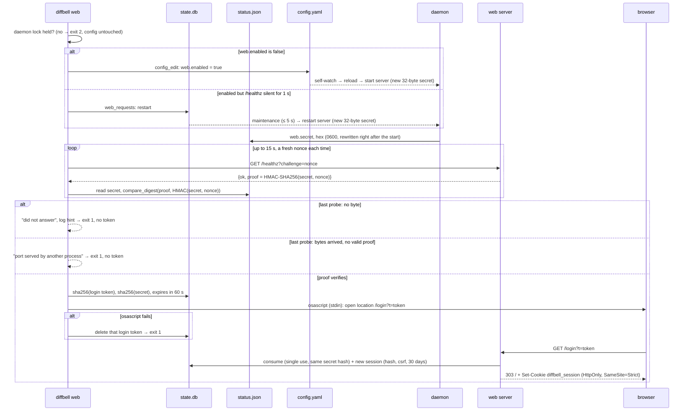

- **Lifecycle:** started at startup when enabled. Every reload re-syncs it: a change
  of `web.enabled` / `web.port` stops or starts it, and a reload while it is down
  starts it. The reload (on the pump) only spawns that start/stop in the
  background, serialized on the web lock, so file watching never waits on uvicorn;
  shutdown cancels it before stopping the server. A `web_requests` restart row (consumed by maintenance; rows older than
  60 s are ignored, also at consume time) restarts it. Each start gets a new
  secret, published to `status.json` at once; a stop or crash removes it from
  `status.json` at once. The web task is **not** in the supervised set: a crash is
  logged, opened as the serious problem `web` and recorded in the snapshot (`web.running: false`,
  `last_error`), and watching goes on. On shutdown the server stops before
  `wm.stop`, so the port is released.
- **Health:** the dashboard reads `Daemon.status_snapshot()` (the dict
  `status.json` holds, minus the secret: the dashboard copies only `running`,
  `port` and `last_error`), including `watchman_version` from the connect-time
  `version` query, Telegram health from the outbox, and the health registry's
  current `problems` from `state.db` (badges, the status sentence). No poll ever calls Watchman
  or the Bot API. The page polls every 5 s while its tab is visible and stops while
  it is hidden. A poll re-fetches as many of the newest rows as are loaded (50 to
  200) and merges them with older rows loaded through **Load more**, so those stay
  and get status updates; if the page no longer reaches the loaded rows (a hidden
  tab, a daemon restart), the older rows are dropped rather than leaving a gap.
  **Load more** pages with the keyset cursor `before_id` (`Store.query_events`), not
  an offset, so new rows arriving at the top never shift it.
  A card's `last_change_at` is the newest event's creation time (after the
  debounce), so changes that collapsed away don't count, and a project whose
  events are all older than the prune (30 days) reads "no changes yet".
- **Security:** bound to 127.0.0.1. The `Host` must be `127.0.0.1:<port>` or
  `localhost:<port>` (DNS rebinding). `/api/*` needs the session cookie and a body
  of at most 1 MiB; mutations need `X-Diffbell-Token` (CSRF) and a same-origin or absent
  `Origin`. These checks run in the middleware before routing. The CSP is
  `default-src 'self'; frame-ancestors 'none'; base-uri 'none'; form-action 'self'`,
  so there is no inline script or style. `/api/*` responses are
  `Cache-Control: no-store`; `/static/*` responses are `no-cache` (revalidated on
  every load), so an upgraded page never mixes old and new files. Responses never contain the contents of
  redacted files, the bot token or the chat id; `GET /api/events/{id}` returns the
  stored redacted diff (see *Stored diffs* below).
- **Port squatting:** each server start generates a 32-byte secret, written only
  into `status.json` (created 0600) and never served or logged.
  `/healthz?challenge=<nonce>` answers with HMAC-SHA256(secret, nonce).
  `diffbell web` uses a fresh nonce per probe and mints a login token only
  after a proof verifies, so a process that grabs the port while our server is
  down (and may have recorded earlier `/healthz` answers) never receives one. The
  probe bypasses proxy settings, never follows redirects or decompresses, reads at
  most 64 KiB within a hard deadline, and counts the first byte of any reply (even
  a non-HTTP one, or an unexpected error after it) as "something answered". The
  CLI keeps probing with fresh nonces for up to 15 s; if the last probe received
  any byte without a valid proof → "served by another process" (exit 1), otherwise
  → "did not answer". The token row also stores the secret's
  hash, and `/login` redeems it only on the server start it was minted for.
- **Login link:** the URL must fully match
  `http://127.0.0.1:[0-9]+/login?t=[A-Za-z0-9_-]+(&next=telegram)?` (ASCII only;
  `next` is an allowlist of one value: `/login` redirects it to
  `/?view=settings&section=telegram`, a missing or unknown one to `/`) and goes to
  `/usr/bin/osascript -` on stdin, never in argv. The CLI never prints it.
- **Edits:** only through `web.config_edit` (optimistic `config_version`); the
  daemon picks them up through the normal self-watch reload. The daemon records
  the version (SHA-256 of the file bytes, hashed before and after parsing) it last
  applied and last rejected in the snapshot (`config_version`,
  `config_rejected_version`, also in `/api/dashboard`), so the page confirms a save
  as soon as the reload happens, or reports the rejection. Settings shows that
  outcome in its save bar; its validation and messages come from the server
  (see *Settings* below).
- **Preview:** a local walk (symlinks listed, never followed; hidden entries
  walked; only always-excluded directories and child-probed `"/**"` ignores pruned;
  unreadable or vanishing directories are skipped). It is targeted (Plan 6): when
  every watched pattern contains "/" and begins with a literal folder, it starts only where one can match, a
  literal path's parent folder (its entries only) or an anchored glob's literal
  prefix (everything below); prefix names are matched against the real listing
  case- and NFC/NFD-insensitively (never `stat`), and a symlinked, missing or
  pruned prefix ends that start. The matched files and redacted flags equal the
  whole-tree walk's (`tests/web/test_preview_targeted.py` keeps it as the oracle). The path must be an existing
  directory under the home directory (not the home itself).
  `tests/integration/test_preview_parity.py` compares it with a real Watchman
  query.
- **Tree and counts:** `POST /api/browse` lists one folder for the editor's tree;
  each component is opened with `O_NOFOLLOW` relative to the parent's descriptor,
  and a folder the preview always excludes (matched case- and
  NFC/NFD-insensitively) is refused. The dashboard's "files watched" is computed
  on demand, only when `GET /api/dashboard` asks for it, never on a timer; the
  fetch never waits (the value is null until the first count ends, then stale
  values are served while a recount runs). Browse, preview and counts share the
  Previewer's two worker slots; counts take at most one.
- **Snooze and controls** (notify controls spec §5): `POST /api/projects/{name}/snooze`
  (`until` in the future and at most 30 days ahead, or null; 404 for a name not in
  the config) and `DELETE …/snooze` (204, idempotent) go through the same guard as
  every `/api/*` route. `/api/dashboard` adds each project's (also a missing one's) `snooze` and
  `notify_on` and `quiet: {window, active, ends_at}`; `/api/events` accepts
  `status=held|skipped` and returns `held_until` (null for an indefinite snooze or a hold already due),
  `held_reason` and `batch_id`; `/api/events/{id}` adds `batch_size`,
  `batch_report` (the catch-up's merged report, current redaction re-applied) and
  `reports_state` (`stored`, `pruned`: older than 30 days, or `not_recorded`).
  `notify_on` and the quiet hours are saved through `/api/projects` and
  `/api/settings` (`config_edit`).
- **Activity, folders, attention and the editor** (Plan 7, [ADR 0015](adr/0015-page-actions-activity-and-attention.md)):
  `/api/dashboard` adds `activity` (14 local-day buckets per configured project:
  `day`, `since`, `until`, `total`, `failed`; one `Store.activity` query), each
  project's absolute `folder` (null while it is not resolved) and `web.editor`;
  `/api/events?status=attention` selects failed and held events; `/api/settings`
  returns and `PUT /api/settings` accepts `web: {editor}` (nothing else under
  `web`). Stored report entries may carry `first_line`, returned only when it is
  an integer of at least 1 and the file is not redacted today.
- **Stored diffs** ([ADR 0010](adr/0010-stored-diffs.md)): before each Telegram
  attempt the notifier stores the redacted report in `event_reports` (one row
  per event, replaced by each attempt; pruned with the event by cascade).
  `GET /api/events/{id}` returns it with `telegram_lines` / `telegram_files`, so
  the page marks where the message's excerpt ended. A file the current
  redaction list covers is returned without lines and without its note (a
  symlink's note names its target), even if it was stored with them, and the
  event's `added` / `removed` are recounted without it. The list rows keep the
  stored counts. Caps: lines clipped to 500 characters; a file is stored whole
  only if the JSON, plus the stubs (path, kind, redacted) of every later file,
  stays within 64 KiB, so the stubs always fit unless the paths alone exceed it.

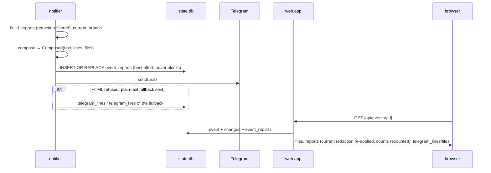

- **The page** (`static/`, no build step): `index.html` loads one module,
  `js/main.js`, the only module that touches the DOM or `window` at load time.
  It hands the document, `fetch` and the URL to the others, which are
  import-safe (the node tests import them with traps on those globals). Icons
  come from one sprite, `icons.svg`. Details:
  - every request has a 15 s timeout (60 s for the test notification); only a
    status-0 `ApiError` (network error or timeout) reads "Can't reach the
    daemon", a 503 goes to the outage banner (one line per endpoint, numeric
    path segments folded to `:id`), other API errors go to the feed note;
  - the visible status line is not a live region; a hidden `#status-live` gets
    the status sentence without its ticking "last change" clause, written only
    when it changes;
  - the detail pane restores focus to the same control after each rebuild;
    the keyboard-shortcut overlay is a modal that traps Tab (at the document,
    while open) and returns focus on close, to its own button when what had
    focus is gone;
  - the tree is a plain nested list (no `tree` role; `aria-expanded` on each
    folder's button), and a tick writes `patternForPath(rel)`, which escapes
    glob characters (`*` → `[*]`, `?` → `[?]`; `[`, `]`, control characters,
    backslash, edge whitespace and an enclosing quote → `?`);
  - colours are CSS tokens for both themes, including `--on-accent` / `--on-bad`
    for text on filled buttons in dark mode and `--knob` (a switch's knob, in all
    three token blocks); the theme is chosen in Settings → This page (System,
    Light or Dark; the `diffbell_theme` cookie, read by the server at first paint);
  - the node tests skip without node ≥ 22.7 unless `DIFFBELL_REQUIRE_NODE=1`.

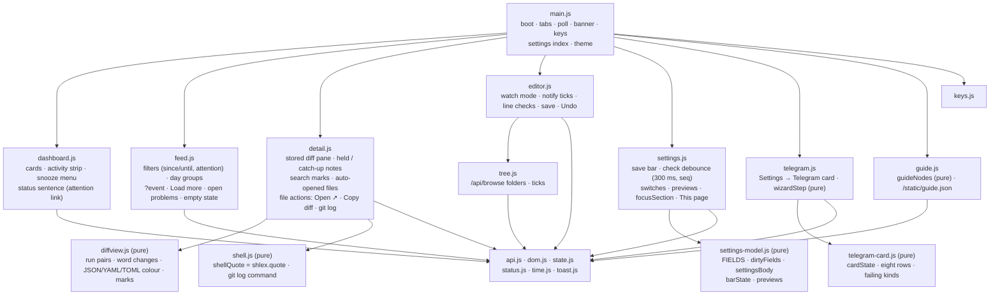

### Settings (the save bar and server-owned validation)

[ADR 0019](adr/0019-settings-save-bar-validation-telegram-failures.md). Settings is one column of five
sections (`telegram`, `notifications`, `schedule`, `patterns`, `page`;
`?view=settings&section=<id>` accepts exactly those ids, `feed.SECTIONS`, and
`settings.js` `focusSection` scrolls to the section and focuses its heading).
One save bar covers the nine fields `PUT /api/settings` writes
(`settings-model.js` `FIELDS`); Telegram (its wizard), Theme (the `diffbell_theme`
cookie, applied at once) and Sessions are outside it.

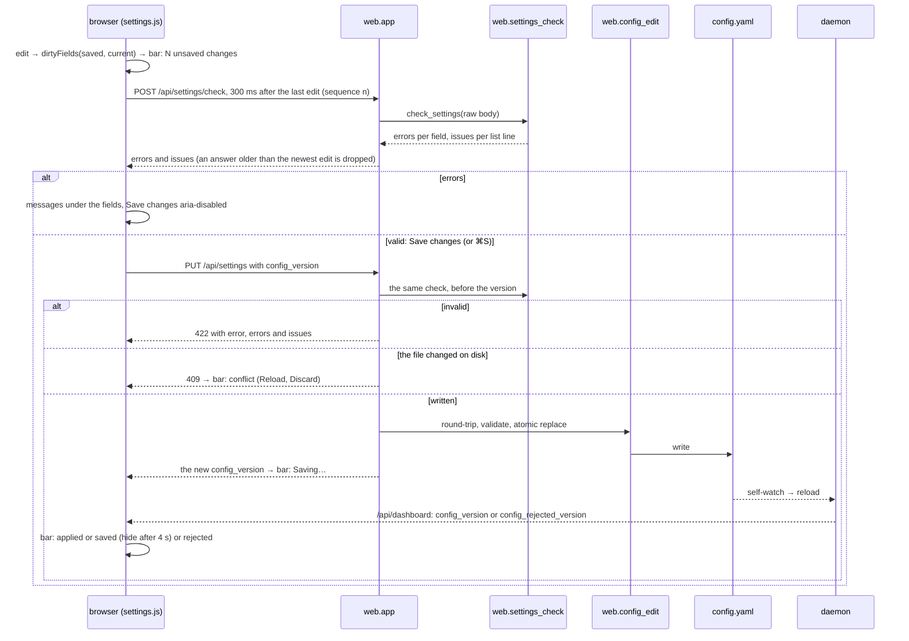

- `POST /api/settings/check` takes the PUT body without `config_version`, writes
  nothing, and answers `{"errors": {field: message}, "issues": {list: [{line,
  reason}]}}` (empty: valid). Fields: `quiet_seconds`, `max_wait_seconds`,
  `max_lines`, `quiet_from`, `quiet_to`, `heartbeat`; lists: `defaults`, `ignore`,
  `redact`. `PUT /api/settings` runs the check before comparing `config_version`;
  its 422 keeps `error` (a one-line summary of at most five problems, then
  "…and N more") and adds `errors` and `issues`.
- One message table (`settings_check.MESSAGES`): the check, the PUT and
  `config_edit.describe_validation_error` (through `settings_check.message_for`)
  say the same sentence; the daemon's own config-load error keeps its text.
  Numbers arrive as typed; empty or non-numeric is an error, never 0. The page
  keeps no rule or message of its own.
- Applied and rejected are the existing `saveOutcome` comparison of the saved
  version with the dashboard's `config_version` / `config_rejected_version`
  (polled every 5 s); after 3 polls with neither the bar says "Saved: the daemon
  reloads the config." (the `saved` state). A hand edit the daemon rejects is not
  the page's save and shows only as the `config` problem.
- Edits stay in memory when the view is left; unloading the page while dirty sets
  `beforeunload`. Built-in lists and their counts come only from
  `GET /api/settings`.

### Telegram setup (the wizard)

[ADR 0018](adr/0018-unconfigured-start-and-web-bot-setup.md). Settings → Telegram
(`?view=settings&section=telegram`) is one card with eight rows
([ADR 0019](adr/0019-settings-save-bar-validation-telegram-failures.md)):
`telegram-card.js` (`cardState`, pure) picks the row, `telegram.js` renders it. The
wizard while the slot is empty (reason `both`, `bot token` or `chat id`), "An
earlier save didn't finish" (reason `unfinished save`, Set up again), Connected
(with or without the chat's name, never the chat id), and the failing rows by
`failing.kind`: token rejected (`auth`), can't reach Telegram (`retryable`),
message refused (`bad_request`) and its pre-v7 variant (`legacy_failed`).
**Replace bot** runs the same wizard.
The guide is the page's fourth view (`?view=guide&step=<id>`, not a tab), rendered
from `static/guide.json`; `docs/telegram-setup.md` is generated from the same file
(`make guide`, drift-tested). All endpoints need a session; POSTs need the CSRF token.

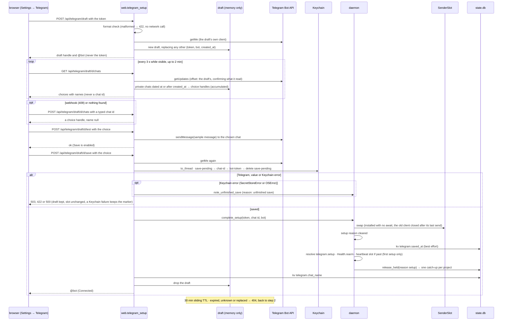

- The draft lives only in the web context: never in SQLite, a log, browser storage or
  a response. A page reload starts again at step 2.
- `GET /api/telegram` reads the slot, kv `telegram.chat_name`, the outbox and the
  daemon's cached setup reason only, with no Bot API or Keychain call
  (`configured`, `bot`, `chat_name`, `last_ok`, `last_error`, `reason`,
  `failing`); the dashboard's "Telegram isn't set up — N changes are waiting" and
  the card's held line use `telegram.configured` and `counts.held` from
  `/api/dashboard`.
- `reason` (`both`, `bot token`, `chat id`, `unfinished save`, or null once set
  up) is set at start from the credential check, set to `unfinished save` when the
  wizard's save meets a Keychain error (`SecretStoreError` or `OSError`, also a
  cancelled save's write; never `ValueError`) through `note_unfinished_save`, and
  cleared by `complete_setup`.
- `failing` is null unless `telegram_health()` reports an error. Otherwise
  `Store.telegram_failure()` works over the undelivered events (`failed`, or
  pending/held with attempts) whose `last_error_at` is after the cutoff: the later
  of the last bot save (kv `telegram.saved_at`, written by `complete_setup`) and
  the last successful send (the newest sent event's `created_at`; no delivery time
  is stored, so a late delivery of a long-held event can leave the cutoff early and
  over-report, never hide, a failure). It gives `kind` by precedence over their
  `last_error_kind` (`auth` > `bad_request` = `legacy_failed` > `retryable`, a tie
  to the newest error; a failed row with no kind is `legacy_failed`, a pending or
  held one being retried is `retryable`), `since` (their earliest `created_at`),
  `failed`, `waiting` and `error` (the newest stored text of that kind, shown only
  for `bad_request` and `legacy_failed`); no row left after the cutoff is null.

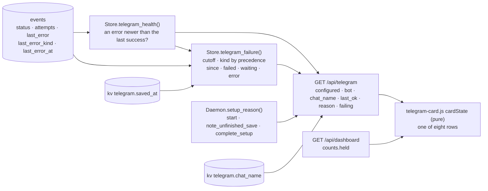
- One save at a time across all drafts (`Drafts.saving`): any Save while one
  runs, even another tab's draft, is 409 "Saving is already in progress." (a
  cancelled request keeps the mark until its Keychain thread ends); `complete_setup`'s steps after the swap (resolve, rearm, heartbeat
  slot, release) are best effort and logged.
- `POST /api/test-notification` answers 409 "Telegram isn't set up yet." while the
  slot is empty. **Send test message** lives in the card, in the Connected, can't
  reach Telegram, message refused and pre-v7 rows (the defined "try now": no retry
  endpoint); **Show failed changes** opens the failed filter (`?status=failed`, the
  dashboard being the default view), and is left out while no change failed.
- Error bodies are fixed texts and never contain the token, the chat id or a URL:
  malformed token 422, rejected token 422, webhook (or another `getUpdates` reader)
  409, a chat that refuses the test 422, a value `save_credentials` refuses 422,
  Telegram unreachable 503, Keychain write 500, unknown or expired draft 404.

### Search inside diffs and diff rendering

[ADR 0013](adr/0013-diff-search-and-readability.md). The page's search (`/`, the
`q` of `GET /api/events`) matches a change path, as before, **or**, from 2
characters on, a stored diff line of a file today's redaction list does not cover.

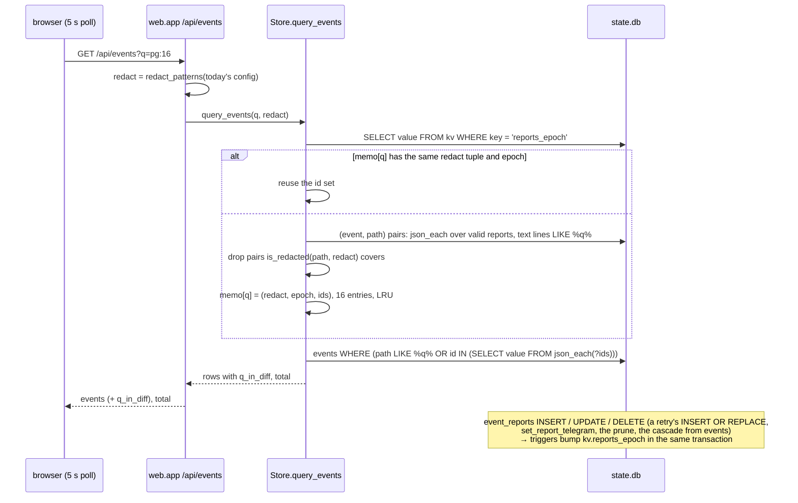

- **Rules:** only strings in an entry's `lines` array are searched (never keys,
  notes or JSON escapes); an entry marked redacted, without a text path, or an
  invalid stored report never matches and never raises. `%`, `_` and `\` match
  literally; ASCII letters fold case, other letters and NFC/NFD forms don't.
  `total` and the `before_id` paging use the same condition. `q` is trimmed first
  (a whitespace-only `q` is no `q`); a 1-character `q` searches paths only (the page hints "2+ characters search inside diffs").
- **The page:** a row with `q_in_diff` shows an "in diff" tag; the detail marks
  every match with `<mark>` (the same ASCII-only folding, over the whole line,
  marker included), opens a collapsed file holding a match until the person
  toggles it during that search (a redacted or truncated file has no lines and
  stays closed), and labels the hidden rest "Show all N lines (k matches)" ("1
  match"). A line that is not a string counts as its text (`null` as ""), so a
  malformed stored report can't break the count. The search box and its hint sit
  in their own `.search-field` (the hint outside the `<label>`, linked by
  `aria-describedby`, updated on every keystroke). The detail also marks and
  auto-opens matching lines in the event's catch-up copy (`batch_report`), although
  the server searches only `event_reports`: harmless, since today's redaction list
  is applied to both before they are returned.
- **Diff rendering** (`diffview.js`, pure, import-safe): per file, runs of `-`
  lines directly followed by `+` lines are paired by position over all stored
  lines (then cut at the Telegram divider); a token LCS marks the changed tokens
  (`wdel`/`wadd`; whole-line colour only over 400 characters or under 40% shared
  tokens). Light syntax colour by extension (`.json`, `.yaml`/`.yml`, `.toml`),
  per line: keys `sk`, strings `ss`, numbers and literals `sn`, comments `sc`
  (outside quotes), a YAML list `-` `sp`; a value cut across lines stays plain.
  The ranges and the marks merge into segments; `detail.js` builds spans and
  `<mark>`s with `h()` (text only), and falls back to the plain line on any
  failure. Segment text is then passed through `visible` (the same mapping as
  `render.visible`; a uniform-CRLF file's trailing "\r" dropped first), so control
  and line-separator characters show as one visible character each and the
  offsets hold (ADR 0017, "Display of control characters"). Colours are CSS tokens for both themes (`--sk`, `--ss`, `--sn`, `--sc`,
  `--wadd`, `--wdel`, `--mark`).
- **Cards:** a corner group (`card-tools`, outside the card's button) holds the
  problem badges, then the snooze bell (or **Resume** while snoozed, the status
  line then reading "Watching · snoozed until 14:00"; Resume's title "Snoozed
  until 14:00: turn notifications back on"). The corner is at most 104 px wide
  (badges wrap inside it) and the card title reserves only what it holds (a
  `corner-*` class on the wrap, updated every poll: the bell 32 px, two items or
  Resume 60 px, three or more 112 px), so it can't
  cover the name; a long name ends in an ellipsis with the full name as its title.
  A count that stopped at the walk's cap ("500+ files") has a title saying so.
  Feed rows show relative times in Today's group (the local calendar day) and
  `HH:MM` in older ones; the detail of an event sent in a catch-up reads "Sent in
  catch-up #12 with 3 other changes" ("with 1 other change", or just "Sent in
  catch-up #12" when alone).

### Page actions, activity and needs attention

[ADR 0015](adr/0015-page-actions-activity-and-attention.md). Nothing here runs
anything on the user's machine: links and copied text only.

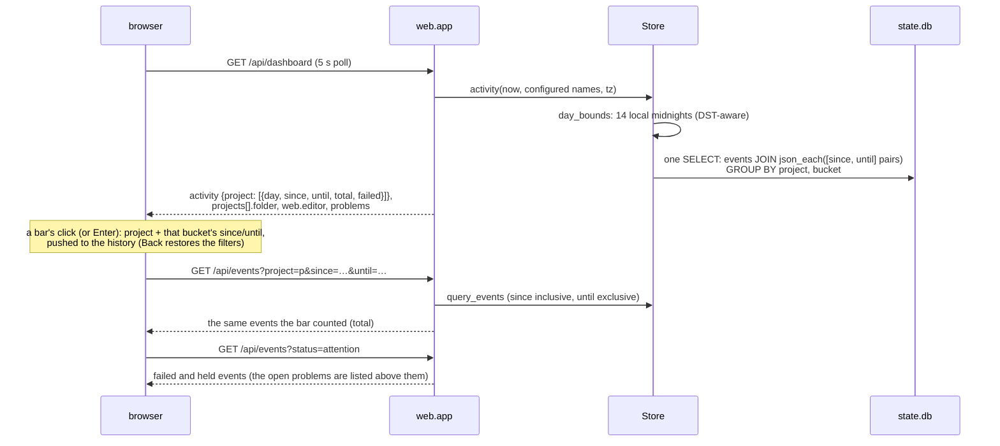

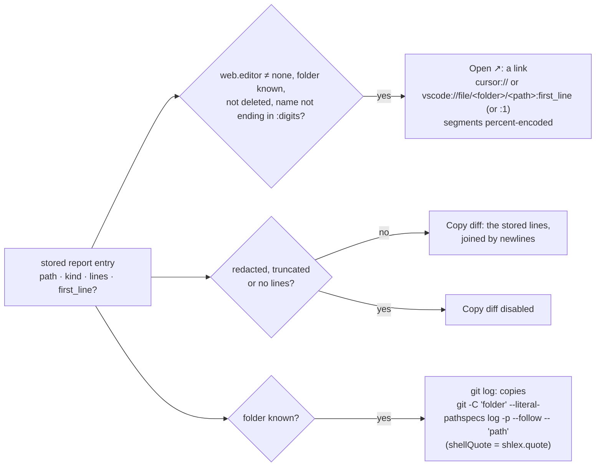

- **Activity strip:** fourteen bars per card (outside the card's button, drawn at
  its foot), heights as classes `h0`…`h10` scaled to the busiest day (a day with
  any event is at least `h1`; none: a 2 px stub), a red tick under a day with a
  failed event, a title and `aria-label` such as "Thu 8 Oct · 4 changes (1
  failed)". One tab stop per strip (roving `tabindex`), ←/→/Home/End move, Enter
  applies. The feed keeps `since`/`until` in its filters and the URL (digits only);
  they win over the From/To dates, which show the bucket's day; a date typed by
  hand drops them.
- **Needs attention:** a Status choice; while selected, the open problems (the
  dashboard's `problems`) are compact rows above the results (badge, message, the
  fix with Copy). The header sentence for projects in trouble or a serious
  problem outside any project is a link that selects it and clears the other
  filters. Back (`popstate`, `restoreUrl`) restores that URL's filters and view (a
  URL without `?view=` is the dashboard).
- **Empty states:** with no events listed, one message ("No events match these
  filters.", "Nothing needs attention.", or the first-run one), no empty list box,
  and no empty detail pane (one column).

## Operations: `doctor`, `upgrade` and the test Watchman

ADR 0014. Both commands print what to do and never do it themselves.

- **`doctor`** runs thirteen checks side by side, each within 5 s: the install source
  (a Homebrew install is ok as itself, ADR 0021; otherwise `install-source.json`, or under `upgrade` the hidden `--pending-source` JSON of
  the source being installed; a malformed one, or one whose folder is gone, fails,
  never falling back), the config, Watchman (`--no-spawn --no-local version`,
  then `--no-spawn --no-local --no-pretty watch-list`; without `--no-local` the
  client answers `version` itself when no server runs), launchd (`agent_status`), liveness (`status.json` running,
  fresh within 2 min, no `last_failure`), the database (`mode=ro`: `user_version`,
  `quick_check`, `foreign_key_check`; an older version is "not migrated yet; restart
  the daemon" with the fix `diffbell install`, a newer one or a failed check
  points to restoring a backup), open problems, the Keychain
  (`secrets.credentials`: not set up, one item missing or the `save-pending` marker
  is a warning), Telegram `getMe` (no token: a warning, "not set up, nothing to
  check"; a network failure is a warning, a bad token a failure), `/healthz`, permissions (`paths.loose_modes`) and the log
  since the last start. Exit 2 if any failed.
- **`upgrade`:** a Homebrew install (`launchd.running_from_homebrew`) is refused
  before anything else (ADR 0021).

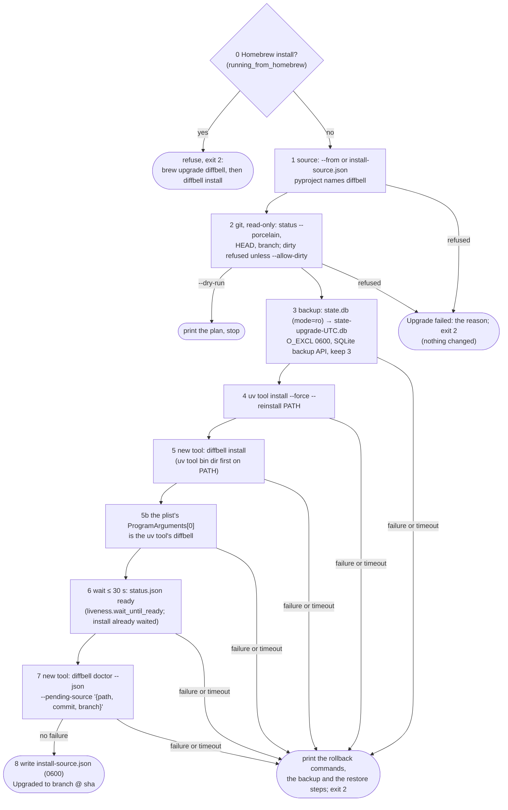

- **Rollback after a migration:** `upgrade` reads the schema version (`mode=ro`)
  before step 3 and again when it prints the rollback. If the new daemon migrated
  the database (v5 → v6), the previous code can't use it (an old daemon opens a v6
  database without error, then every per-project query fails): the text says
  restoring is REQUIRED and names the candidates, the `state-upgrade-*.db` backup
  first, then the Store's `state-pre-v6-*.db`. A bump that only adds nullable
  columns (`upgrade.ADDITIVE_VERSIONS`: v7, [ADR 0019](adr/0019-settings-save-bar-validation-telegram-failures.md))
  is not such a migration: the previous code still runs on it, so v6 → v7 alone
  keeps the restore optional.

- **`install` moves an old install first** (`rename_install.run`, only when a dev-watchman install is found; [ADR 0020](adr/0020-rename-to-diffbell.md)): <!-- old-name -->

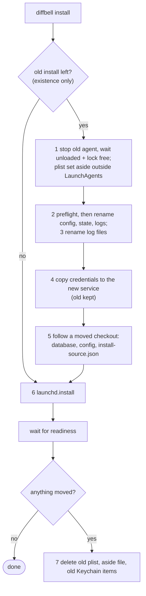

  Rollback: while no old folder is missing, the old install goes back as it was (a
  loaded agent is started again; one that wasn't loaded only gets its plist back).
  Otherwise the agent stays stopped with its plist set aside, and rerunning
  `diffbell install` finishes the move. `upgrade` refuses while an old install is
  left, and `doctor` has an "Old install" row.

- **`install` waits for readiness** (`liveness.wait_until_ready`, shared with
  `upgrade` step 6): up to 30 s, polling every 0.5 s, until `status.json` has
  `running` true, a numeric `last_started_at` later than just before the launchd
  install, `connected` true, no project `pending`, and the web block `running`
  when `web.enabled`. It then prints the pid, the subscribed project count and
  the web UI's address (never the secret or a login link); on timeout it names
  what is missing and exits 1, so `upgrade` fails at step 5.
- **The test Watchman** (`tests/private_watchman.py`, `tests/conftest.py`): one
  private `watchman --foreground` per test session on a socket in a short temp
  directory, `WATCHMAN_SOCK` pointing at it (pywatchman, and so `WatchmanClient`,
  honour it; the `watchman` CLI does not). Fixture commands use pywatchman on that
  socket. Guard 2 compares the user's watch list (`--no-spawn --no-local`, default
  socket) before and after the session. At the end the fixture stops the instance
  and leaves `WATCHMAN_SOCK` pointing at its dead socket, so a leaked client can
  never fall back to the default socket (`watchman get-sockname`).

## Crash and restart behavior

- A change is journaled together with its hash and clock in one transaction, so
  a kill at any later point can't lose it. Unflushed journal rows are reloaded
  into the debouncer at startup; batches still inside their debounce window at
  shutdown are not flushed, they are reported after the restart.
- A batch that collapses to nothing deletes its journal rows in the same
  transaction, so a restart can't resurrect it. `create_event` verifies every
  kept row was linked and rolls back otherwise.
- Delivery is exactly-once in normal operation. A crash between a successful send
  and committing `sent` can resend that one batch.
- `wmclient` reconnects with backoff (1 s → 60 s). On reconnect every project is
  resubscribed (new generation) from its stored clock, and the config is
  reloaded. If Watchman is unreachable for more than 5 minutes, one alert is
  sent, followed by one "reachable again" when it's back (a shorter outage sends
  nothing, and is logged at INFO; the WARNING is logged once the grace is over).
- Store details: `state.db` and its `-wal`/`-shm` are 0600; opening the store
  creates the file 0600 and tightens an existing one (an earlier version left it
  0644). `events.id` is `AUTOINCREMENT` (ids are never reused after a
  prune), `changes(event_id)` and `events(project_id, created_at)` (the dashboard's
  last change) are indexed, and `PRAGMA user_version` (7) marks the schema;
  version 2 added `web_logins`, `web_sessions` and `web_requests` with
  `CREATE TABLE IF NOT EXISTS` (a `web_logins` table without `secret_hash` gains
  the column), version 3 added `event_reports`, version 4 added `snoozes` and
  `batch_reports` and rebuilt `events` (new statuses, `batch_id`, `held_reason`),
  version 5 added `problems` and `kv` (`CREATE TABLE IF NOT EXISTS`, no rebuild),
  version 6 added `projects` and rebuilt `clocks`, `hashes`, `events`, `changes` and
  `snoozes` on `project_id`, version 7 added `events.last_error_kind` and
  `events.last_error_at` (`_migrate_v7`: `ALTER TABLE events ADD COLUMN` under
  `BEGIN IMMEDIATE`, re-checked there, no rebuild since no CHECK changes; rows from
  before have neither). A database from before v6 runs the frozen `SCHEMA_V5`,
  then the v4 and v6 migrations (the v6 rebuild uses the frozen
  `EVENTS_V6_COLUMNS`); a new or v6 one runs `SCHEMA`. The v7 step then runs at
  every open and adds whichever column is missing; a new database already has both
  from `SCHEMA`.
  The old `alerts` table is not in `SCHEMA`: `DROP TABLE IF EXISTS alerts` runs at
  **every** open, since code from before v5 recreates it without lowering
  `user_version` (a rollback, then a re-upgrade); a lock held by another process
  reads as "database busy", as in a migration. An added index alone needs no
  version bump (`CREATE INDEX IF NOT EXISTS` runs at every open).
- The v4 rebuild (`store._migrate_v4`): the connection opens with foreign keys
  ON; `PRAGMA foreign_keys=OFF` (verified) **before** `BEGIN IMMEDIATE` (inside a
  transaction the pragma is a no-op, and `DROP TABLE events` would cascade into
  `changes` and `event_reports`), re-check under the lock that `events` still
  lacks the v4 columns (a concurrent opener may have migrated), copy the rows with
  their ids, drop, rename, recreate the indexes (`events_project_created`,
  `events_status_next`, `events_batch`), keep the AUTOINCREMENT sequence, check the
  row counts of `events`, `changes` and `event_reports` and `foreign_key_check`
  (runtime guards: a mismatch raises and rolls back), set `user_version = 4`,
  create `snoozes` and `batch_reports` (in the same transaction, so a failure
  leaves no table behind), `COMMIT`, then foreign keys back on (also after a
  failure), verified. Any failure rolls back: the database stays at v3, unchanged,
  and the daemon exits with "database migration failed: …" (exit 2). launchd
  restarts it every 10 s with the same result; `diffbell uninstall` stops
  that, and a later retry is safe.
- The v6 rebuild (`store._migrate_v6`), the same procedure: first a copy with
  SQLite's backup API to `state-pre-v6-<UTC>.db` (0600, written as `.part` and
  renamed; a retry keeps the first one). Under the lock it re-checks that `events`
  still lacks `project_id`, creates `projects`, and gives each folder of a clock row
  (`watch_root` joined with `relative_root`) one inactive row named after the name
  with the latest clock `updated_at`, and each name without a clock row its own row
  with a NULL path (`temp.v6_ids` maps every name to its id; `sync_projects` later
  gives such a row the folder its name is configured at, unless that folder already
  has a row). It rebuilds the five
  tables: `events` and `changes` keep every row and id; `clocks`, `hashes` and
  `snoozes` keep only the latest name's rows when several names share an id (the set
  the watcher uses now, so nothing re-baselines). Then the AUTOINCREMENT sequence,
  the row counts of `events`, `changes`, `event_reports` and `batch_reports` and
  `foreign_key_check`
  (which also checks every `project_id`), `user_version = 6`, `COMMIT`. Any failure
  rolls back to v5, unchanged. Events held by a merged-away name's snooze are
  released. A backup failure is a `MigrationError`; a retry keeps the first backup
  (skipped if one exists). `sqlite3.connect` waits up to 30 s for another
  process's write lock; past that the open fails with "database busy (another
  diffbell process is using it); retry" (exit 2, also during the schema
  script).
- `prune` (daily, and at startup) deletes the `event_reports` of every event older
  than 30 days whatever its status, then those events unless they are `pending` or
  `held`. A catch-up batch is aged by its newest member and its still-open ones:
  while any member is kept, every member and its `batch_reports` row stay, so a
  Retry re-holds the whole batch.
- A web UI crash or restart never affects watching. Sessions are stored (hashed) in
  `state.db`, so they survive daemon restarts; a pending login link does not
  survive a web restart (its secret hash no longer matches).
